# 🗓 Calendar & Tasks Card

<br>

[](https://github.com/hacs/integration)
[](https://github.com/korova-sq/calendar-tasks-card/releases)
[](https://github.com/korova-sq/calendar-tasks-card/stargazers)
[](https://github.com/korova-sq/calendar-tasks-card/releases)
[](https://github.com/korova-sq/calendar-tasks-card/releases/latest)
[](https://github.com/korova-sq/calendar-tasks-card/issues)
[](https://opensource.org/licenses/MIT)
[](https://buymeacoffee.com/korova.sq)

<br>


<br>

## 🤔 What is Calendar & Tasks Card?

Calendar & Tasks Card is a unified agenda view for [Home Assistant](https://www.home-assistant.io/) that combines **calendar events** and **todo tasks** in a single, clean timeline.

Most agenda cards on HACS show either calendar events OR todo tasks. This card unifies them with smart grouping — designed for dashboards where you want to see "what's coming up" at a glance, mixing appointments and reminders without switching cards.

## ✨ Features

- 🛠 **Visual editor** for all options (no YAML editing required)
- 📅 **Unified view**: events and tasks in one timeline, sorted by date
- 🗓️ **Monthly grid view**: switch to a classic month calendar with event dots, tap-a-day popup, and month navigation
- 🔀 **View switch button**: a header button to flip between agenda and month view without opening the editor (session-only, reverts to the default on reload)
- 🎨 **Color picker**: native Home Assistant colour picker per entity (theme colours), auto-assigned from the theme palette when unset
- ✅ **Task completion**: tick tasks directly from the card
- 🚨 **Overdue section**: tasks past their deadline highlighted in red
- 📋 **No Date section**: active tasks without a due date (can be hidden)
- 🗂 **Completed section**: recently finished tasks for context
- ⏱ **Relative time**: "Tomorrow", "In 3 days", "Yesterday", "1 week overdue"
- 🗓 **Multi-day events**: events spanning several days appear on each one, with a day counter
- 📍 **Event location**: shows the location of calendar events with optional click-to-maps
- 📅 **Current date in header**: optionally show today's localised date under the title
- 📆 **Week numbers**: ISO 8601 week separators (toggle on/off)
- 🔽 **Collapsible**: hide everything with one click, state persists
- 📋 **Max events visible**: optionally limit visible events with a smooth internal scrollbar
- 📏 **Compact mode**: reduced spacing option for tighter layouts
- ☀️ **Weather support**: optional today's weather widget and per-day forecast
- 🖼 **Custom background**: transparent mode or background image with a light/dark overlay
- 🎨 **card-mod support**: style the card with [card-mod](https://github.com/thomasloven/lovelace-card-mod)
- ➕ **Add event/task**: inline form to create calendar events and todo tasks without leaving the card
- 🔍 **Filters**: hide events/tasks by keyword (`exclude`), show only matching ones (`include`), or hide duplicates across calendars
- 🔄 **Force refresh**: button to update all integrations on demand
- 🌐 **Internationalization**: English, Italian, German, French, Polish and Swedish — auto-detects from system (card display + visual editor)
- 🕐 **Time format**: 12h or 24h, follows system preferences
- 👆 **Customizable actions**: tap, hold, double-tap (Home Assistant standard)
- 🪶 **Clean YAML**: only non-default settings are saved
- 🚀 **Zero dependencies**: no other custom cards required

## 📸 Screenshots

### Overview

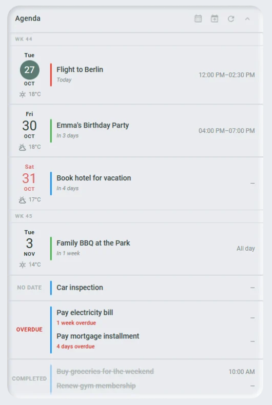

### Event progress

| | |
|:---:|:---:|
| 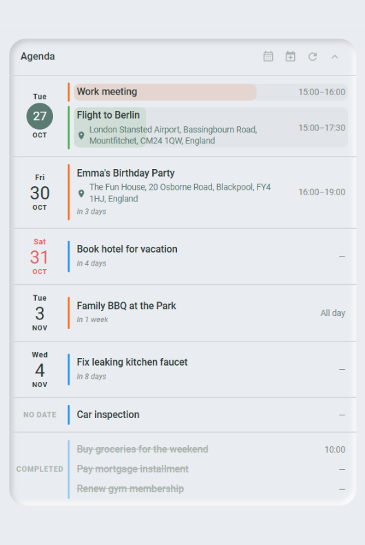 | 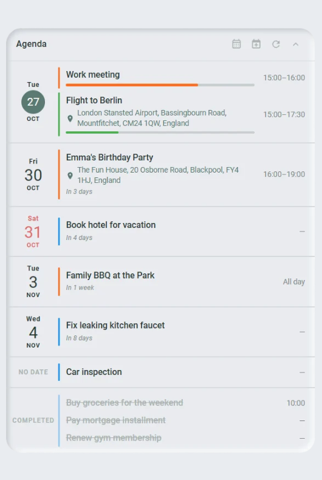 |
| `bar` mode | `line` mode |

### Themes

The card automatically follows your Home Assistant theme — light or dark.

| | |
|:---:|:---:|
| 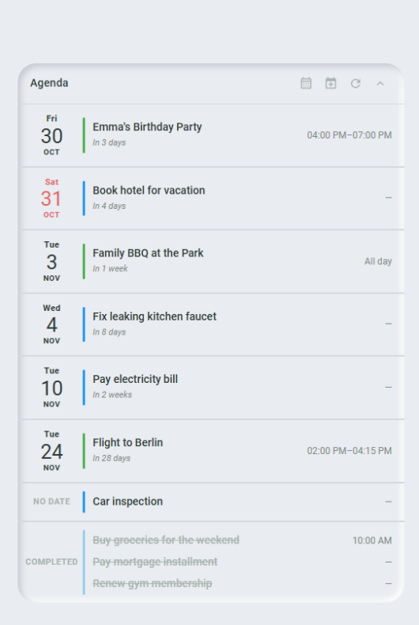 | 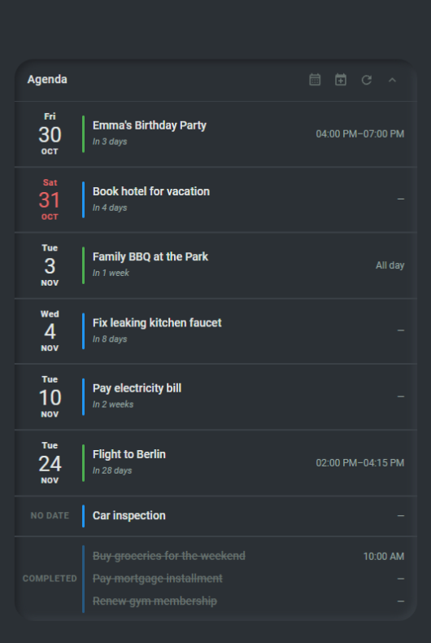 |
| ☀️ Light theme | 🌙 Dark theme |

### Monthly calendar

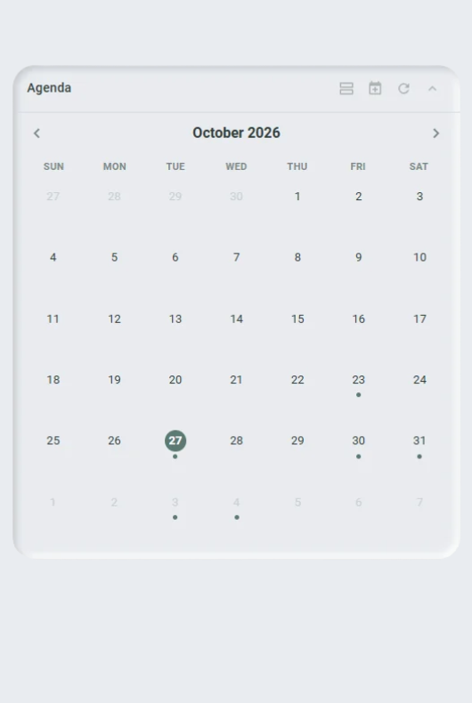

| | |
|:---:|:---:|
| 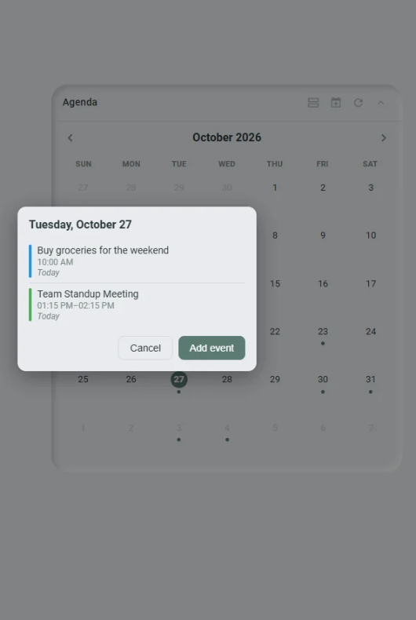 | 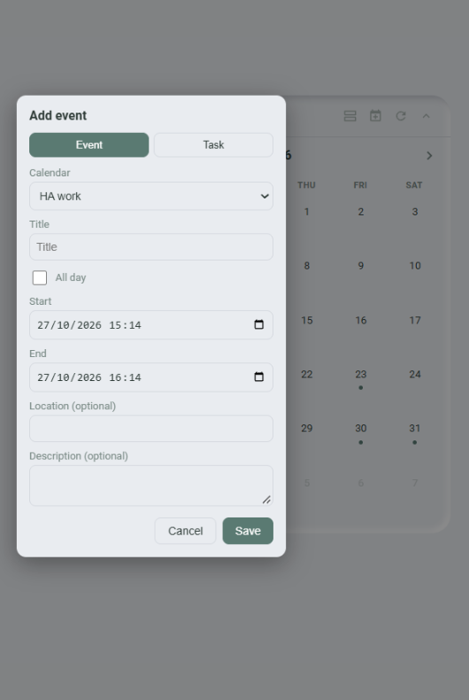 |
| Day popup | Add event / task |

### Tasks view

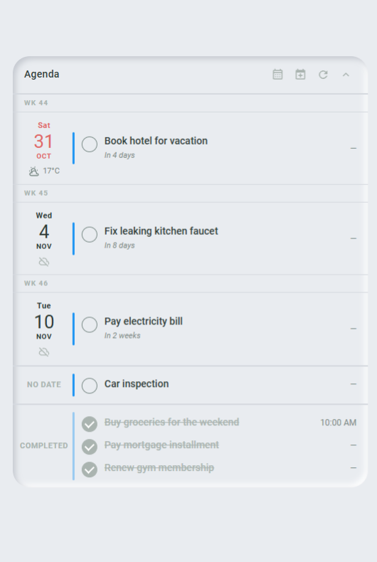

### Weather support

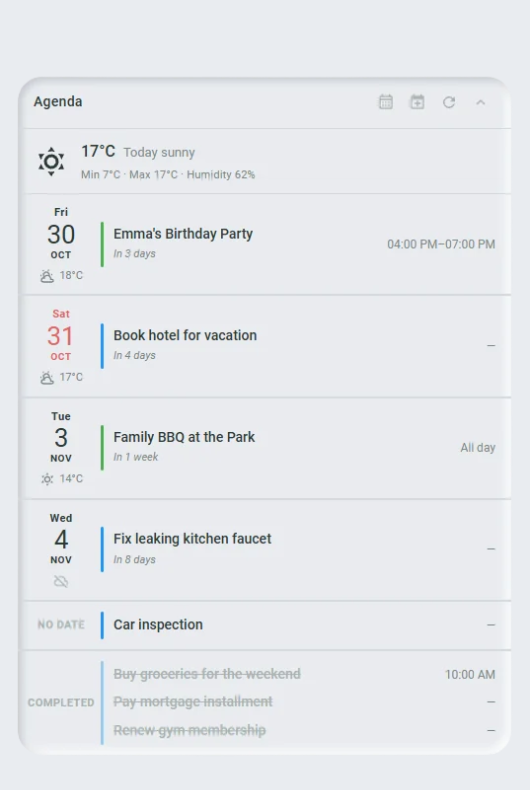

Display weather information from any HA `weather.*` entity with two independent options:

- **Today's weather widget** (top of card): shows current condition, temperature, min/max for the day, and humidity.
- **Per-day weather** (next to each date): icon and temperature for the next 5-7 days. For days beyond the forecast range, a discrete cloud-off icon is shown as placeholder.

Both options can be enabled independently — show only one, the other, or both. Enable them in the **Weather** section of the visual editor.

### Editor — color picker

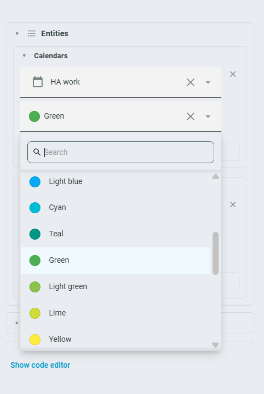

## 📦 Installation

### HACS (recommended)

Calendar & Tasks Card is available in the default HACS store:

1. Open HACS in Home Assistant
2. Search for **Calendar & Tasks Card**
3. Click **Download**
4. Reload your browser (Ctrl+F5 or Cmd+Shift+R)

### Manual installation

1. Download `calendar-tasks-card.js` from the [latest release](https://github.com/korova-sq/calendar-tasks-card/releases)
2. Copy it to `/config/www/calendar-tasks-card.js`
3. Go to **Settings → Dashboards → Resources** (top right ⋮ menu)
4. Click **Add Resource**
5. URL: `/local/calendar-tasks-card.js`, Type: **JavaScript Module**
6. Reload your browser

## ⚙️ Quick start

Once installed, add the card to your dashboard:

1. Edit your dashboard
2. Click **Add Card**
3. Search for **Calendar & Tasks Card**
4. Add your entities and configure via the visual editor

Or via YAML:

```yaml
type: custom:calendar-tasks-card
calendars:
  - calendar.family
todos:
  - todo.shopping
```

That's it. The card will work with sensible defaults.

## 📚 Configuration

The card has a complete visual editor with six sections:

### 📋 Entities
- **Calendars**: any `calendar.*` entity from Home Assistant
- **Todo lists**: any `todo.*` entity (Local To-do, Google Tasks, CalDAV, etc.)

Each entity has a native Home Assistant colour picker where you can choose a theme colour. The colour applies to the vertical bar next to each event/task in the card. Leave it on **Default** to let the card assign a colour automatically from the theme palette (rotating through distinct colours for different entities).

> **Upgrading from a version before 1.10.0?** The colour system moved to Home Assistant's native palette and colours set in older versions are not carried over — open the editor and re-pick the colour for each calendar/list you had customised.

### 🎛 General
| Option | Default | Description |
|---|---|---|
| `title` | `Agenda` | Card title |
| `show_title` | `true` | Show the title bar |
| `show_current_date` | `false` | Show today's date as a subtitle under the title, localised to the card language |
| `days` | `7` | Days to look ahead |
| `show_refresh` | `true` | Show 🔄 refresh button |
| `show_add_event` | `false` | Show ➕ button in the header to add events/tasks (see below) |
| `show_view_switch` | `false` | Show a header button to switch between agenda and month view (session-only; the editor's `month_view` toggle sets the persistent default) |
| `show_collapse_button` | `true` | Show ▲ collapse button |
| `limit_events_visible` | `false` | Enable scrollbar to limit visible events |
| `max_events_visible` | `3` | Number of events visible when `limit_events_visible` is true |
| `compact_mode` | `false` | Reduced vertical spacing for tighter layout |
| `show_weather` | `false` | Master toggle to enable weather features |
| `weather_entity` | `""` | HA weather entity to use (e.g. `weather.home`) |
| `show_weather_today` | `true` | Show today's weather widget at the top of the card |
| `show_weather_per_day` | `false` | Show weather icon+temp next to each day's date |
| `exclude` | `[]` | List of keywords; events and tasks with titles containing any keyword will be hidden (partial match, case-insensitive) |
| `include` | `[]` | Allowlist of keywords; when set, ONLY events and tasks whose title contains one of them are shown (partial match, case-insensitive). Applied before `exclude` |
| `filter_duplicates` | `false` | Hide the same event/task appearing on multiple calendars/lists (events matched by title + start + end + location, tasks by title + due date; first occurrence kept) |

### 🌐 Localization
| Option | Default | Values |
|---|---|---|
| `language` | `auto` | `auto`, `en`, `it`, `de`, `fr`, `pl`, `sv` |
| `time_format` | `auto` | `auto`, `24h`, `12h` |
| `first_day_of_week` | `auto` | `auto`, `monday`, `sunday`, `saturday` |

### 👁 Display
| Option | Default | Description |
|---|---|---|
| `month_view` | `false` | Show a monthly calendar grid instead of the agenda list, with event dots, a tap-a-day popup and month navigation |
| `show_week_number` | `false` | ISO 8601 week separators (agenda) / week-number column (grid) |
| `show_end_time` | `false` | Show `HH:MM–HH:MM` for events |
| `multi_day_events` | `true` | Show multi-day events on every day they span, with a `(2/6)` day counter |
| `show_empty_days` | `false` | Show days with no events |
| `show_relative_time` | `true` | Relative time labels: "Tomorrow", "In 3 days", and — for imminent items with a precise time — "In 3 hours" / "In 45 min" |
| `event_progress` | `off` | Progress indicator for an event currently in progress: `off`, `line` (a thin bar under the event) or `bar` (a full-width progress bar, filled in the calendar's colour). Mutually exclusive with the relative-time label on the same event |
| `show_source` | `false` | Show entity name as subtitle |
| `show_description` | `true` | Show event/task description |
| `show_location` | `false` | Show event location with map pin icon (calendar events only) |
| `location_clickable` | `false` | Make location clickable, opens Google Maps in new tab |

### 🖼 Background
| Option | Default | Description |
|---|---|---|
| `transparent` | `false` | Remove card background, shadow and border so it blends into the dashboard |
| `background_image` | `null` | Background image, as a URL or a `/local/…` path |
| `background_overlay` | `0` | Veil over the image, from `-1` (full white) through `0` (none) to `+1` (full black), to keep the text readable |

Background image and transparency are mutually exclusive: if an image is set, it takes precedence.

Past a dark overlay threshold, the card text automatically switches to a light colour. Transparency also works with "glass" themes and card-mod.

These options use the same names as in [sun-weather-card](https://github.com/korova-sq/sun-weather-card), so both cards are configured the same way.

### ➕ Add event/task

When `show_add_event` is enabled, a button appears in the header that opens an inline form to create a new calendar event or todo task — without leaving the card or reloading the page.

- Choose **event** or **task** (only shown if you have both calendars and todo lists configured)
- Pick the target calendar or todo list from a dropdown
- **Events**: title, all-day toggle, start/end, optional location and description
- **Tasks**: title, optional due date, optional description

The button only appears if at least one calendar or todo list is configured. The form uses Home Assistant's official `calendar.create_event` and `todo.add_item` services, so creating events only works for calendars that support it (e.g. Local Calendar, CalDAV) — read-only calendars won't accept new events. Recurring events aren't supported, since the underlying service doesn't offer it; create those from the Calendar tab as usual.

### 🔀 View switch button

When `show_view_switch` is enabled, a button appears in the header to switch between the agenda list and the monthly grid. The `month_view` toggle in the editor sets the **default** view; the button changes the view for the current session only and reverts to the default when the page reloads. This keeps the editor as the single source of truth for the persistent default, so users who don't enable the button can still choose the view.

### 🎨 card-mod

The card supports [card-mod](https://github.com/thomasloven/lovelace-card-mod). Add a `card_mod:` block to the card config to apply custom CSS. Styles are re-applied after every render, so they survive refreshes and view changes.

```yaml
type: custom:calendar-tasks-card
calendars:
  - calendar.family
card_mod:
  style: |
    ha-card {
      border: 2px solid var(--primary-color);
      box-shadow: 0 4px 12px rgba(0, 0, 0, 0.2);
    }
```

card-mod must be installed separately (via HACS). If it isn't installed, the `card_mod` block is simply ignored.

### ✅ Tasks
| Option | Default | Description |
|---|---|---|
| `show_no_date` | `true` | Show the "No Date" section (active tasks without a due date); set to `false` to hide it |
| `show_overdue` | `true` | Show Overdue section |
| `overdue_days` | `0` | Limit overdue (0 = all) |
| `overdue_position` | `bottom` | Position of the Overdue section: `bottom` (below the days) or `top` (above them) |
| `show_completed` | `true` | Show Completed section |
| `completed_days` | `7` | Limit completed to N days |
| `completed_position` | `bottom` | Position of the Completed section: `bottom` or `top` |
| `allow_complete` | `false` | Show checkbox to mark complete |

### 👆 Interactions
Three configurable actions following Home Assistant standards:
- **Tap**: single click
- **Hold**: long press
- **Double tap**: two quick clicks

Each can be: `none`, `more-info`, `toggle`, `navigate`, `url`, `call-service`, or `assist`.

## 📝 Complete YAML example

```yaml
type: custom:calendar-tasks-card
title: Agenda
days: 7
calendars:
  - calendar.family
  - calendar.work
todos:
  - todo.shopping
  - todo.work_tasks
show_week_number: true
show_relative_time: true
show_overdue: true
show_completed: true
completed_days: 7
allow_complete: true
show_location: true
location_clickable: true
language: auto
time_format: 24h
first_day_of_week: monday
entity_colors:
  calendar.family: "#d93025"
  calendar.work: "#4285f4"
  todo.shopping: "#34a853"
tap_action:
  action: navigate
  navigation_path: /lovelace/agenda
```

## 🗂 How tasks are classified

The card automatically sorts tasks into different sections:

| Task state | Where it appears |
|---|---|
| Active, today or future date | In the corresponding day in the agenda |
| Active, no date | 📋 **No Date** section |
| Active, **past date** | 🚨 **Overdue** section (red highlight) |
| Completed (any date) | 🗂 **Completed** section (if enabled) |

## ⚠️ Known limitations

### 🍎 iCloud CalDAV: task completion is broken
Marking a task complete from Home Assistant currently fails for iCloud CalDAV with `Calendar.search() got multiple values for argument 'sort_keys'`. This is a [known bug in Home Assistant core](https://github.com/home-assistant/core/issues), not in this card.

**Workaround**: use Local To-do, Google Tasks, or [Radicale](https://radicale.org/) for tasks you want to complete from HA. iCloud CalDAV still works fine for read-only viewing.

### 📅 Google Tasks: no time-of-day on tasks
The Google Tasks API only stores the date, not the time. Tasks from Google Tasks will show `—` instead of a time, even if you set one in the Google Tasks app. This is a Google limitation.

### ☑ Calendar events can't be "completed"
Calendar events are appointments, not actions — they don't have a completion state. Only tasks (`todo.*` entities) show the completion checkbox.

### 🐌 iCloud propagation delay
Reminders created in the Apple Reminders app on iPhone can take up to 1 hour to appear on Apple's public CalDAV server. Not a card issue. For lower latency, consider a self-hosted CalDAV server like [Radicale](https://radicale.org/) or [Baikal](https://sabre.io/baikal/).

## ⚠️ Disclaimer

This card is provided as-is for convenience. **Do not rely on it as the sole notification system for time-critical events** (medical appointments, flights, important deadlines, etc.). Always set independent notifications in your calendar app or phone for events that matter.

The card depends on third-party integrations (CalDAV, Google Tasks, etc.) which may have their own bugs, latencies, or limitations outside of this card's control. See [Known limitations](#%EF%B8%8F-known-limitations) above.

See the [LICENSE](LICENSE) for full terms — this software is provided without warranty of any kind.

## 🔧 Troubleshooting

**The card doesn't show up after installation**
- Did you reload the browser with Ctrl+F5 (hard refresh)?
- Check Settings → Dashboards → Resources: is the URL correct and the type "JavaScript Module"?
- Open the browser console (F12) and look for errors

**The refresh button gives an error**
- Make sure all calendar and todo entities exist and aren't disabled
- If you've edited the YAML manually, check there are no empty entries (`- ""`)

**Task completion doesn't work**
- Check the limitations section above
- Test the operation manually: Developer Tools → Actions → `todo.update_item`

**Colors don't apply**
- Make sure you clicked "Save" in the editor after picking a color
- Colors are stored in `entity_colors` in the YAML

## 💬 Discussion

Discussion and support thread on the Home Assistant community forum:
[Calendar & Tasks Card on the HA community](https://community.home-assistant.io/t/calendar-tasks-card-unified-agenda-for-events-and-todos/1010940)

## ☕ Support

If you enjoy this card and want to say thanks, a coffee is always welcome!

[](https://buymeacoffee.com/korova.sq)

## 🤝 Contributing

Issues and pull requests are welcome. Please:
- Test changes against multiple integrations (Local To-do, CalDAV, Google Tasks if possible)
- Keep the code style consistent with the rest of the file
- Update the README if you add new options

## 🃏 My other cards

| Card | Description |
|---|---|
| [🌤 Sun Weather Card](https://github.com/korova-sq/sun-weather-card) | Sun position, weather forecast and outdoor conditions in one card |
| [🕐 World Time Card](https://github.com/korova-sq/world-time-card) | Multiple world clocks with timezone support |

## 📄 License

[MIT](LICENSE) © 2026 korova-sq
